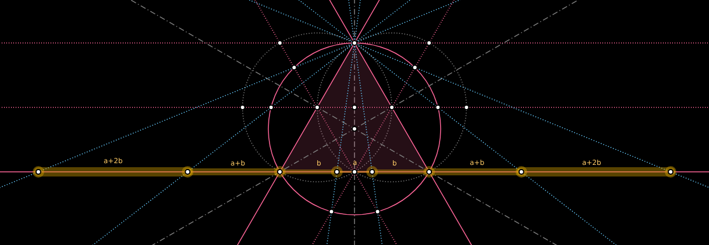

<picture>
  <source media="(prefers-color-scheme: dark)" srcset="./vesica-phi-dark.svg">
  <source media="(prefers-color-scheme: light)" srcset="./vesica-phi-light.svg">
  
</picture>

# GEOMETOR

### *Exploring the architecture of all that is*

[**geometor.com**](https://geometor.com) · [**All Books & Catalogs →**](https://geometor.com/books/) · [**61-Repo Atlas**](https://geometor.com/projects/) · [**YouTube (`@geometor`)**](https://www.youtube.com/@geometor) · [**Discussions**](https://github.com/orgs/geometor/discussions) · [**phi ARCHITECT**](https://github.com/phiarchitect)

---

## One Language of Form

Geometry is humanity's most concise language for documenting nature, proportion, and deductive truth. Most dynamic geometry software relies on floating-point approximations—reporting that two segments are merely *numerically close* to $1.6180339\dots$ At **GEOMETOR**, every construction begins with **two points in an empty field** and is grounded in **100% exact symbolic algebra** ([SymPy](https://www.sympy.org/)). Every point, line, circle, quadrance, spread, cross-ratio, and intersection preserves its exact algebraic identity ($\sqrt{2}$, $\sqrt{3}$, closed-form radical towers, and the Divine Proportion):

$$\phi = \frac{1 + \sqrt{5}}{2}$$

Across **61 interconnected repositories**, GEOMETOR recasts 2,400 years of classical geometry, projective synthesis, botanical morphogenesis, epistemological philosophy, and machine reasoning into **one consistent, executable symbolic grammar**:

- **74 Scholarly Book Codices (*39 Authors*)**: Multi-track critical editions of foundational public-domain treatises (*Greek, Latin, Italian, German, French, and English*) backed by **8,400+ primary-source folio scans** and calibrated `.euclid-graphic` vector figures.
- **11 Mathematical Catalogs**: One-item-per-page symbolic compendia documenting classical dependency graphs, triangle centers, rational trigonometry laws, 3D polyhedra, golden ratio constructions, Fibonacci identities, and theorem-proving engines.

> **Complete Digital Scriptorium & Symbolic Catalogs**: Browse direct links to all **74 working Book Codices** and **11 Mathematical Catalogs** at [**geometor.com/books/**](https://geometor.com/books/).

---

## Key Projects

### I. Symbolic Core, 3D Polyhedra & Archive Architecture

| Project | Role in the Architecture | Live Docs & Packages |
| :--- | :--- | :--- |
| **[`model`](https://github.com/geometor/model)** | **Exact Symbolic Construction Engine** — Compass-and-straightedge algebra in `SymPy`: closed-form 2D intersections, rational trigonometry invariants (`quadrance`, `spread`, `cross_ratio`), `@proposition` proof ledgers, and ancestral DAGs. | [Docs](https://geometor.github.io/model/) · [PyPI](https://pypi.org/project/geometor-model/) |
| **[`explorer`](https://github.com/geometor/explorer)** | **Interactive SVG Workbench** — Browser canvas & symbolic CLI (`[ A B ]`, `( A B )`, `/ A B /`, `< A B C >`) with scrubbable step timelines, KaTeX coordinate inspection, and theme-adaptive SVG export. | [Docs](https://geometor.github.io/explorer/) |
| **[`divine`](https://github.com/geometor/divine)** | **Golden Ratio Scanner & Construction Catalog** — Automated detector of exact $\phi$ sections and harmonic ranges, paired with a symbolic catalog of classical and modern golden constructions (Odom, Hofstetter, *Cut-the-Knot*). | [Docs & Catalog](https://geometor.github.io/divine/constructions/) · [PyPI](https://pypi.org/project/geometor-divine/) |
| **[`polyhedra`](https://github.com/geometor/polyhedra)** | **Symbolic 3D Polyhedra & Leonardo's 1509 Plates** — Exact algebraic models over $\mathbb{Q}(\sqrt{2}, \sqrt{3}, \phi)$ for Platonic, Archimedean, Catalan, and Kepler–Poinsot solids plus Leonardo da Vinci's 60 polyhedral plates. | [Solids Catalog →](https://geometor.github.io/polyhedra/solids/) · [Leonardo](https://geometor.github.io/polyhedra/leonardo/) |
| **[`elementarium`](https://github.com/geometor/elementarium)** | **Passive Optical Archive** — Zero-context geometric bootstrap architecture on fused-silica plates for 100,000-year mathematical preservation. | [Docs](https://geometor.github.io/elementarium/) |

---

### II. Flagship Mathematical Catalogs

| Catalog | Scope & Symbolic Corpus | Explore Online |
| :--- | :--- | :--- |
| **[`elements`](https://github.com/geometor/elements)** | **Elements 2.0 & The G-Index (`G.1`–`G.601`)** — Computable topological dependency DAG of Euclid's definitions, postulates, common notions, and propositions across *Pseudocode*, *Python*, and *Heath Prose*. | [**Explore G-Index →**](https://geometor.github.io/elements/elements2/) · [Videos](https://www.youtube.com/playlist?list=PLUXlBs_QySgw) |
| **[`etc`](https://github.com/geometor/etc)** | **Encyclopedia of Triangle Centers ($X_1$–$X_{53144}$)** — Clark Kimberling's *ETC* in exact barycentrics: **4,000+ compiled centers** across **62 collections** and **16,000+ interactive SVGs** on four reference triangles. | [**Explore Centers →**](https://geometor.github.io/etc/centers/) · [Videos](https://www.youtube.com/playlist?list=PLKVZJpKGr5zc) |
| **[`wildberger`](https://github.com/geometor/wildberger)** | **Rational Trigonometry & Universal Geometry** — Exact `SymPy` proofs and `geometor.model` constructions for Norman J. Wildberger's Quadrance, Spread, Triple Quad/Spread/Cross Laws, Spread Polynomials, and Chromogeometry. | [**Explore Catalog →**](https://geometor.github.io/wildberger/topics/) |
| **[`fundamentals`](https://github.com/geometor/fundamentals)** | **The Fred W. Seelig Constructive Archive** — **55 foundational topics** (`F.1`–`F.55`), **353 manuscript folios**, and **59 spreadsheets** uniting triangle concurrency, harmonic duality, and Conway notation. | [**Explore Archive →**](https://geometor.github.io/fundamentals/topics/) |
| **[`knott`](https://github.com/geometor/knott)** · **[`huntley`](https://github.com/geometor/huntley)** · **[`livio`](https://github.com/geometor/livio)** · **[`posamentier`](https://github.com/geometor/posamentier)** | **Fibonacci & Golden Ratio Catalog Suite** — Four complementary symbolic catalogs covering Fibonacci/Lucas identities, Wythoff's Nim, *spira mirabilis* gnomons, circle-chord $\phi$ constructions, and historical myth triage. | [Knott](https://geometor.github.io/knott/catalog/) · [Huntley](https://geometor.github.io/huntley/catalog/) · [Livio](https://geometor.github.io/livio/catalog/) · [Posamentier](https://geometor.github.io/posamentier/catalog/) |
| **[`codes`](https://github.com/geometor/codes)** | **Geometric Computing & Theorem-Proving Engines** — Architectural catalog and Rosetta comparisons across *GeoCoq*, *JGEX* (Area & Full-Angle Methods), *GeoGebra Discovery*, *SymPy*, and *CGAL*. | [**Browse Engines →**](https://geometor.github.io/codes/systems/) |

---

### III. Flagship Digital Scriptorium Editions

Selected cornerstone codices from our **39-author, 74-book** Digital Scriptorium powered by [`photon-platform/publish`](https://github.com/photon-platform/publish) — [**view all 74 working Book Codices on `geometor.com/books/` →**](https://geometor.com/books/):

| Scriptorium | Featured Treatises & Archival Provenance | Read Online |
| :--- | :--- | :--- |
| **[`euclid`](https://github.com/geometor/euclid)** & **[`byrne`](https://github.com/geometor/byrne)** | **Euclid's *Elements* (Books I–XIII), *Data* & Byrne's 1847 Chromatic Edition** — Heath's complete 3-volume *Elements* (**1,416 folios**, **831 calibrated SVGs**), Heiberg/Menge *Data*, and Oliver Byrne's primary-colored visual pseudocode (**339 RGB folios**). | [*Elements*](https://geometor.github.io/euclid/heath/) · [*Data*](https://geometor.github.io/euclid/data/) · [Byrne 1847](https://geometor.github.io/byrne/coloured_euclid/) |
| **[`archimedes`](https://github.com/geometor/archimedes)** · **[`apollonius`](https://github.com/geometor/apollonius)** · **[`ptolemy`](https://github.com/geometor/ptolemy)** · **[`pappus`](https://github.com/geometor/pappus)** | **Alexandrian Synthesis** — Seven treatises of Archimedes (including *The Method*), Apollonius's *Conics* I–VII, Ptolemy's *Almagest* & *Planisphaerium* (**1,054 folios**), and Pappus's *Synagoge* (**445 folios**), alongside [`heron`](https://geometor.github.io/heron/), [`menelaus`](https://geometor.github.io/menelaus/), and [`nicomachus`](https://geometor.github.io/nicomachus/). | [Archimedes](https://geometor.github.io/archimedes/) · [Apollonius](https://geometor.github.io/apollonius/) · [Ptolemy](https://geometor.github.io/ptolemy/) · [Pappus](https://geometor.github.io/pappus/) |
| **[`plato`](https://github.com/geometor/plato)** · **[`aristotle`](https://github.com/geometor/aristotle)** · **[`proclus`](https://github.com/geometor/proclus)** · **[`aquinas`](https://github.com/geometor/aquinas)** · **[`hoenen`](https://github.com/geometor/hoenen)** | **Noetic & Philosophical Foundations** — Five Platonic dialogues, five Aristotelian treatises, Proclus's *In Euclidem*, six Thomistic commentaries on *materia intelligibilis*, Nicholas of Cusa ([`cusa`](https://geometor.github.io/cusa/)), and Petrus Hoenen's 1954 *De Noetica Geometriae* (**300 folios**). | [Plato](https://geometor.github.io/plato/) · [Aristotle](https://geometor.github.io/aristotle/) · [Proclus](https://geometor.github.io/proclus/) · [Aquinas](https://geometor.github.io/aquinas/) · [Hoenen](https://geometor.github.io/hoenen/) |
| **[`fibonacci`](https://github.com/geometor/fibonacci)** · **[`piero`](https://github.com/geometor/piero)** · **[`pacioli`](https://github.com/geometor/pacioli)** · **[`durer`](https://github.com/geometor/durer)** · **[`kepler`](https://github.com/geometor/kepler)** | **Renaissance Proportion & Cosmic Solids** — Fibonacci's *Liber Abbaci* & *Practica Geometriae* (**762 folios**), Piero della Francesca's *Libellus*, Pacioli's 1509 *De Divina Proportione* & 1494 *Summa*, Dürer's 1525 *Underweysung*, and Kepler's 3-book harmonic trilogy. | [Fibonacci](https://geometor.github.io/fibonacci/) · [Piero](https://geometor.github.io/piero/) · [Pacioli](https://geometor.github.io/pacioli/) · [Dürer](https://geometor.github.io/durer/) · [Kepler](https://geometor.github.io/kepler/) |
| **[`pascal`](https://github.com/geometor/pascal)** · **[`ceva`](https://github.com/geometor/ceva)** · **[`euler`](https://github.com/geometor/euler)** · **[`mascheroni`](https://github.com/geometor/mascheroni)** · **[`feuerbach`](https://github.com/geometor/feuerbach)** · **[`steiner`](https://github.com/geometor/steiner)** | **Projective, Compass-Only & Triangle Classics** — Pascal's 1640 *Coniques*, Ceva's 1678 statical concurrency, Euler's 1765 *E325* Euler Line, Mascheroni's 1797 compass-only geometry, Feuerbach's 1822 Nine-Point tangency, and Steiner's 1833 fixed-circle constructions, plus [`petersen`](https://geometor.github.io/petersen/), [`casey`](https://geometor.github.io/casey/), [`lemoine`](https://geometor.github.io/lemoine/), and [`altshiller-court`](https://geometor.github.io/altshiller-court/). | [Pascal](https://geometor.github.io/pascal/) · [Euler](https://geometor.github.io/euler/) · [Mascheroni](https://geometor.github.io/mascheroni/) · [Feuerbach](https://geometor.github.io/feuerbach/) · [Steiner](https://geometor.github.io/steiner/) |
| **[`staudt`](https://github.com/geometor/staudt)** · **[`pasch`](https://github.com/geometor/pasch)** · **[`klein`](https://github.com/geometor/klein)** · **[`hilbert`](https://github.com/geometor/hilbert)** · **[`poincare`](https://github.com/geometor/poincare)** · **[`bertrand-russell`](https://github.com/geometor/bertrand-russell)** | **Modern Projectivity & Axiomatics** — von Staudt's *Geometrie der Lage* & *Beiträge*, Pasch's 1882 *Vorlesungen* (**212 folios**), Klein's *Erlangen Program* & *Famous Problems*, Hilbert's 1899 *Grundlagen*, Poincaré's *Science and Hypothesis*, and Bertrand Russell's *Foundations* & *Principles*. | [Staudt](https://geometor.github.io/staudt/) · [Pasch](https://geometor.github.io/pasch/) · [Klein](https://geometor.github.io/klein/) · [Hilbert](https://geometor.github.io/hilbert/) · [Poincaré](https://geometor.github.io/poincare/) |

---

### IV. Living Geometry, Wave-Field Cosmogony & Machine Reasoning

| Project | Focus | Live Studios, Codices & Observatories |
| :--- | :--- | :--- |
| **[`phyllotaxis`](https://github.com/geometor/phyllotaxis)** | **Botanical Morphogenesis & Golden Divergence** — Symbolic golden-angle packing ($\Phi = 2\pi/\phi^2 \approx 137.50776^\circ$), Fibonacci parastichies, and interactive **2D Canvas + 3D Three.js WebGL** meristem laboratories. | [**Codex & Labs →**](https://geometor.github.io/phyllotaxis/) · [2D](https://geometor.github.io/phyllotaxis/demos/meristem_2d.html) · [3D](https://geometor.github.io/phyllotaxis/demos/propagation_3d.html) |
| **[`thompson`](https://github.com/geometor/thompson)** & **[`hambidge`](https://github.com/geometor/hambidge)** | **Morphological Growth & Dynamic Symmetry** — D'Arcy Wentworth Thompson's 1917 *On Growth and Form* (Plateau angles, Maraldi apex, Cartesian grids) and Jay Hambidge's 1920 *Elements of Dynamic Symmetry* (**174 folios**). | [*Growth & Form*](https://geometor.github.io/thompson/growth_and_form/) · [*Dynamic Symmetry*](https://geometor.github.io/hambidge/dynamic_symmetry/) |
| **[`russell`](https://github.com/geometor/russell)** | **Walter & Lao Russell — *Home Study Course* & *Wave-Field Cosmogony*** — 48-lesson digital codex (**519 folios**, **180 vector figures**) and interactive 3D cube-sphere optical projection models. | [*Home Study Course*](https://geometor.github.io/russell/home_study_course/) · [*Cosmogony*](https://geometor.github.io/russell/cosmogony/) |
| **[`seer`](https://github.com/geometor/seer)** · **[`seer_navigator`](https://github.com/geometor/seer_navigator)** · **[`seer_sessions`](https://github.com/geometor/seer_sessions)** | **Neuro-Symbolic Program Synthesis** — Multi-agent (*Dreamer* + *Coder*) Python `transform()` synthesis for ARC-AGI, `Textual` trajectory TUI, and empirical observatory (**8,514 runs**, **2,939 puzzles**). | [Seer](https://geometor.github.io/seer/) · [Navigator](https://geometor.github.io/seer_navigator/) · [**Observatory →**](https://geometor.github.io/seer_sessions/) |

---

## Explore, Watch & Connect

- **Complete Books & Catalogs Directory**: [**geometor.com/books/**](https://geometor.com/books/) — Direct links to all **74 Book Codices**, **39 Author Scriptoria**, and **11 Mathematical Catalogs**.
- **Central Portal & 61-Repository Atlas**: [**geometor.com**](https://geometor.com) · [**geometor.com/projects/**](https://geometor.com/projects/) · [**Digital Scriptorium Press**](https://geometor.github.io/press/)
- **YouTube (`@geometor`)**: [**youtube.com/@geometor**](https://www.youtube.com/@geometor) — Over **135 dual-format `2560×1440` QHD propositions and vertical Shorts** with pure-interval harmonic cues:
  - [Euclid's *Elements* (G-Index Full Propositions)](https://www.youtube.com/playlist?list=PLUXlBs_QySgw) · [Vertical Shorts](https://www.youtube.com/playlist?list=PLTJvna-1hErU)
  - [*Encyclopedia of Triangle Centers* (`ETC` QHD Series)](https://www.youtube.com/playlist?list=PLKVZJpKGr5zc) · [Vertical Shorts](https://www.youtube.com/playlist?list=PLAvFHUDlqyAw)
- **Community**: Share constructions, translations, and questions in [**GitHub Discussions**](https://github.com/orgs/geometor/discussions).

Led by <a href="https://github.com/phiarchitect"><strong>phi ARCHITECT</strong></a> · Published with <a href="https://github.com/photon-platform/publish"><strong>PHOTON publish</strong></a> · MIT Licensed

