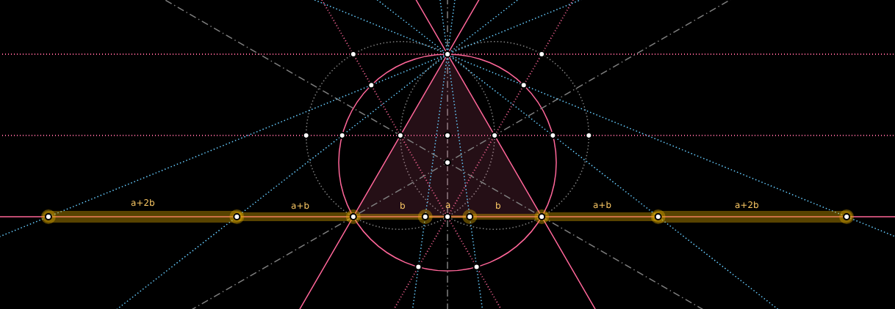
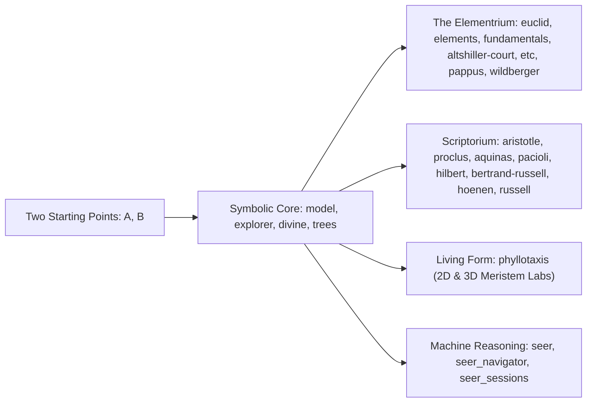

<picture>
  <source media="(prefers-color-scheme: dark)" srcset="./vesica-phi-dark.svg">
  <source media="(prefers-color-scheme: light)" srcset="./vesica-phi-light.svg">
  
</picture>

# GEOMETOR

### *Exploring the architecture of all that is*

[**geometor.com**](https://geometor.com) · [**YouTube (`@geometor`)**](https://www.youtube.com/@geometor) · [**Discussions**](https://github.com/orgs/geometor/discussions) · [**phi ARCHITECT**](https://github.com/phiarchitect)

---

## One Language of Form

Geometry is humanity's most concise language for documenting nature, proportion, and deductive truth. When living systems unfold spiral phyllotaxis or crystal lattices from simple local laws, they invite a foundational question: **How do elementary axiomatic relationships unfold into the full complexity of form and mind?**

Most dynamic geometry software relies on floating-point approximations—reporting that two segments are merely *numerically close* to $1.6180339\dots$ At **GEOMETOR**, every construction begins with **two points in an empty field** and is grounded in **exact symbolic algebra** ([SymPy](https://www.sympy.org/)). Every point, line, circle, quadrance, spread, cross-ratio, and intersection preserves its exact algebraic identity ($\sqrt{2}$, $\sqrt{3}$, exact polynomial roots, and the Divine Proportion):

$$\phi = \frac{1 + \sqrt{5}}{2}$$

Across our repositories, we recast 2,300 years of classical treatises, projective and rational geometry, botanical morphogenesis, epistemological philosophy, and machine reasoning into **one consistent, executable symbolic grammar**—uniting interactive SVG constructions, topological dependency graphs, multi-language **Book Codices**, and visual broadcasts.

---

## I. The Symbolic Core & Discovery Engine

| Project | Role in the Architecture | Live Docs & Packages |
| :--- | :--- | :--- |
| **[`model`](https://github.com/geometor/model)** | **Exact Symbolic Construction Engine** — Compass-and-straightedge algebra in `SymPy`: exact algebraic coordinates, closed-form 2D intersections, rational trigonometry invariants (`quadrance`, `spread`, `cross_ratio`), and full ancestral DAGs. | [Docs](https://geometor.github.io/model/) · [PyPI](https://pypi.org/project/geometor-model/) |
| **[`explorer`](https://github.com/geometor/explorer)** | **Interactive SVG Workbench** — Web canvas & symbolic CLI (`[ A B ]`, `( A B )`, `/ A B /`, `< A B C >`) with scrubbable step-by-step timelines, KaTeX hover inspection, and publication sheet export. | [Docs](https://geometor.github.io/explorer/) |
| **[`divine`](https://github.com/geometor/divine)** | **Golden Ratio & Harmonic Discovery** — Scans symbolic models to automatically uncover exact golden sections ($\phi$), golden chains, and collinear harmonic ranges. | [Docs](https://geometor.github.io/divine/) · [PyPI](https://pypi.org/project/geometor-divine/) |
| **[`trees`](https://github.com/geometor/trees)** | **Monotone Planar Tree Drawings** — Crossing-free straight-line tree layout algorithms grounded in Stern–Brocot mediant trees and Farey rational sequences. | [Repo](https://github.com/geometor/trees) |

---

## II. The Unfolding Canon (*The Elementrium*)

Recasting foundational synthetic, projective, and rational canons into synchronized, multi-track **Book Codices** powered by [`photon-platform/publish`](https://github.com/photon-platform/publish), with bidirectional hover highlighting between text and vector geometry:

| Codex | Scope & Contents | Read Online |
| :--- | :--- | :--- |
| **[`euclid`](https://github.com/geometor/euclid)** | **Sir Thomas L. Heath's *Thirteen Books of Euclid's Elements*** — Complete 3-volume critical edition across **1,416 archival folios**, **465 propositions**, and **831 recalibrated SVGs** in a 2-Track Codex (*Proposition* & *Commentary*). | [**Read Codex →**](https://geometor.github.io/euclid/) |
| **[`elements`](https://github.com/geometor/elements)** | **Elements 2.0 & The G-Index (`G.1`–`G.601`)** — Topological dependency DAG sequencing Euclid's definitions, postulates, common notions, and propositions into a 3-Track Codex (*Pseudocode*, *Executable Python*, and *Heath Prose*) with step playback. | [**Explore G-Index →**](https://geometor.github.io/elements/) · [Videos](https://www.youtube.com/playlist?list=PLUXlBs_QySgw) |
| **[`fundamentals`](https://github.com/geometor/fundamentals)** | **The Fred W. Seelig Constructive Archive** — **55 topics** (`F.1`–`F.55`), **353 manuscript folios**, and **59 spreadsheets** uniting classical triangle synthesis, harmonic duality, Conway notation, and circle–square proportions in a 3-Track Codex. | [**Read Codex →**](https://geometor.github.io/fundamentals/) |
| **[`altshiller-court`](https://github.com/geometor/altshiller-court)** | **Nathan Altshiller-Court's *College Geometry* (1952)** — **334 folios** and **699 numbered articles** across 10 chapters bridging Euclid to modern triangle and circle synthesis (Loci, Similitude, Nine-Point/Feuerbach, Simson, Ceva/Menelaus, Harmonic Division, Inversion, Lemoine/Brocard). | [**Read Codex →**](https://geometor.github.io/altshiller-court/) |
| **[`etc`](https://github.com/geometor/etc)** | ***Encyclopedia of Triangle Centers* ($X_1$–$X_{53144}$)** — Semantic transformation of Clark Kimberling's *ETC*: **4,000+ compiled centers** across **62 collections** and **16,000+ interactive SVGs** across Acute `(5,6,7)`, Egyptian Right `(3,4,5)`, Kepler `(1,√φ,φ)`, and Kimberling `(6,9,13)` triangles. | [**Explore Centers →**](https://geometor.github.io/etc/) · [Videos](https://www.youtube.com/playlist?list=PLKVZJpKGr5zc) |
| **[`pappus`](https://github.com/geometor/pappus)** | **Projective Geometry & *Hexagrammum Mysticum*** — Exact `SymPy` proofs across all 6 $S_3$ Pappus hexagon configurations & 2 Steiner star points, Pascal's 60 lines / 20 Steiner / 60 Kirkman / 15 Plücker configurations, straightedge harmonic fourths, and Golden Conics over $\mathbb{Q}(\phi)$. | [**Read Codex →**](https://geometor.github.io/pappus/) |
| **[`wildberger`](https://github.com/geometor/wildberger)** | **Norman J. Wildberger's *Divine Proportions*** — Exact `SymPy` proofs, `geometor.model` scripts, and interactive SVGs for Quadrance, Spread, pentagonal/golden Spread Polynomials, Triple Quad/Spread/Cross Laws, Chromogeometry, and Conics. | [**Read Codex →**](https://geometor.github.io/wildberger/) |

---

## III. Historical, Epistemological & Axiomatic Scriptorium

| Edition | Treatise & Philosophical Significance | Read Online |
| :--- | :--- | :--- |
| **[`aristotle`](https://github.com/geometor/aristotle)** | **Aristotle — *Loci Geometrici et Noetici*** — Foundational passages from *Posterior Analytics*, *Physics*, *Metaphysics* IX.9, *De Anima*, and *De Caelo* in Bekker Greek, English, and geometric commentary. | [**Read Codex →**](https://geometor.github.io/aristotle/) |
| **[`proclus`](https://github.com/geometor/proclus)** | **Proclus — *Commentary on Book I of Euclid's Elements* (c. 470 AD)** — 4-Track Codex (*English*, *Friedlein Greek 1873*, *Summary*, *Notes*) with a 164-locus concordance on the Eudemian history, *phantasia*, and geometric projection (*probole*). | [**Read Codex →**](https://geometor.github.io/proclus/) |
| **[`aquinas`](https://github.com/geometor/aquinas)** | **Thomas Aquinas — *Scientia Mathematica & Materia Intelligibili*** — 4-Track Codex across 37 sections (*Super Boetium De Trinitate* qq. 5–6, *In Post. Anal.*, *In De Anima*, *In Phys.*, *In Metaph.*) with a 78-locus Hoenen concordance. | [**Read Codex →**](https://geometor.github.io/aquinas/) |
| **[`pacioli`](https://github.com/geometor/pacioli)** | **Fra Luca Pacioli's *De Divina Proportione* (Venice, 1509 / Vienna, 1889)** — 5-Track Codex (*English*, *Italiano 1509*, *Deutsch 1889*, *Latin/Greek*, *Notes*) spanning **318 folios** and **482 woodcuts**, including **Leonardo da Vinci's 60 polyhedra plates**. | [**Read Codex →**](https://geometor.github.io/pacioli/) |
| **[`hilbert`](https://github.com/geometor/hilbert)** | **David Hilbert's *Grundlagen der Geometrie* (1899/1902)** — German original, Townsend English translation, and metamathematical commentary on incidence, order, congruence, segment algebra, and axiom independence. | [**Read Codex →**](https://geometor.github.io/hilbert/) |
| **[`bertrand-russell`](https://github.com/geometor/bertrand-russell)** | **Bertrand Russell — *Foundations of Geometry* (1897) & *Principles* Part VI (1903)** — Critical editions tracing projective order, Cayley–Klein metrical geometry, and relational space. | [**Read Codex →**](https://geometor.github.io/bertrand-russell/) |
| **[`hoenen`](https://github.com/geometor/hoenen)** | **Petrus Hoenen, S.J.'s *De Noetica Geometriae* (Rome, 1954)** — Facing Latin–English edition investigating *intuitive formal abstraction* and how universal geometric necessity arises within concrete construction. | [**Read Codex →**](https://geometor.github.io/hoenen/) |
| **[`russell`](https://github.com/geometor/russell)** | **Walter & Lao Russell's *Home Study Course* (1950–1952)** — 48-lesson digital edition with **180 vector-reconstructed figures** and interactive 3D cube-sphere wave-field geometry. | [**Read Codex →**](https://geometor.github.io/russell/) |

---

## IV. Living Geometry & Machine Reasoning

| Project | Focus | Live Studios & Archives |
| :--- | :--- | :--- |
| **[`phyllotaxis`](https://github.com/geometor/phyllotaxis)** | **Botanical Morphogenesis & Golden Divergence** — Symbolic golden-angle divergence ($\Phi = 2\pi/\phi^2 \approx 137.50776^\circ$), opposing Fibonacci parastichy curves, and live **2D Canvas + 3D Three.js WebGL** meristem propagation studios. | [**Codex & Labs →**](https://geometor.github.io/phyllotaxis/) · [2D](https://geometor.github.io/phyllotaxis/demos/meristem_2d.html) · [3D](https://geometor.github.io/phyllotaxis/demos/propagation_3d.html) |
| **[`seer`](https://github.com/geometor/seer)** | **Program Synthesis for Abstract Visual Reasoning** — Multi-agent (*Dreamer* + *Coder*) neuro-symbolic solver synthesizing verifiable Python `transform()` programs for ARC-AGI challenges. | [Docs](https://geometor.github.io/seer/) |
| **[`seer_navigator`](https://github.com/geometor/seer_navigator)** | **Reasoning Trajectory TUI** — `Textual` terminal browser for inspecting solver hypotheses, synthesized Python iterations, and grid diffs. | [Docs](https://geometor.github.io/seer_navigator/) |
| **[`seer_sessions`](https://github.com/geometor/seer_sessions)** | **Longitudinal Reasoning Observatory** — Empirical archive and static web viewer spanning **8,514 task runs**, **2,939 unique puzzles**, and **475 sessions**. | [**Browse Observatory →**](https://geometor.github.io/seer_sessions/) |

---

## V. Watch & Connect

- **Central Portal**: [**geometor.com**](https://geometor.com) — Interactive Vesica-to-$\phi$ threshold, foundational essays, Masters & Lineage gallery, and project chronicles.
- **YouTube (`@geometor`)**: [**youtube.com/@geometor**](https://www.youtube.com/@geometor) — Over **135 dual-format `2560×1440` QHD propositions and vertical Shorts** with pure-interval harmonic cues:
  - [Euclid's *Elements* (G-Index Full Propositions)](https://www.youtube.com/playlist?list=PLUXlBs_QySgw) · [Vertical Shorts](https://www.youtube.com/playlist?list=PLTJvna-1hErU)
  - [*Encyclopedia of Triangle Centers* (`ETC` QHD Series)](https://www.youtube.com/playlist?list=PLKVZJpKGr5zc) · [Vertical Shorts](https://www.youtube.com/playlist?list=PLAvFHUDlqyAw)
- **Community**: Share constructions, translations, and questions in [**GitHub Discussions**](https://github.com/orgs/geometor/discussions).

Led by <a href="https://github.com/phiarchitect"><strong>phi ARCHITECT</strong></a> · Published with <a href="https://github.com/photon-platform/publish"><strong>PHOTON publish</strong></a> · MIT Licensed

