<picture>
  <source media="(prefers-color-scheme: dark)" srcset="./vesica-phi-dark.svg">
  <source media="(prefers-color-scheme: light)" srcset="./vesica-phi-light.svg">
  
</picture>

# GEOMETOR

### *Exploring the architecture of all that is*

[**geometor.com**](https://geometor.com) · [**YouTube (`@geometor`)**](https://www.youtube.com/@geometor) · [**Discussions**](https://github.com/orgs/geometor/discussions) · [**phi ARCHITECT**](https://github.com/phiarchitect)

---

## One Language of Form

Geometry is humanity's most concise language for documenting nature, proportion, and deductive truth. When living systems unfold spiral phyllotaxis or crystal lattices from simple local laws, they invite a foundational question: **How do elementary axiomatic relationships unfold into the full complexity of form and mind?**

Most dynamic geometry software relies on floating-point approximations—reporting that two segments are merely *numerically close* to $1.6180339\dots$ At **GEOMETOR**, every construction begins with **two points in an empty field** and is grounded in **exact symbolic algebra** ([SymPy](https://www.sympy.org/)). Every point, line, circle, quadrance, spread, cross-ratio, and intersection preserves its exact algebraic identity ($\sqrt{2}$, $\sqrt{3}$, exact polynomial roots, and the Divine Proportion):

$$\phi = \frac{1 + \sqrt{5}}{2}$$

Across **46 interconnected repositories**, we recast 2,400 years of classical treatises, projective and rational geometry, botanical morphogenesis, epistemological philosophy, and machine reasoning into **one consistent, executable symbolic grammar**—uniting two complementary forms of scholarship:

- **Scholarly Editions (*Book Codices*)**: Multi-language critical editions of foundational public-domain works (*Greek, Latin, Italian, German, French, and English*) paired with calibrated interactive `.euclid-graphic` SVGs and runnable `geometor.model` demonstrations.
- **Mathematical Catalogs**: Original one-item-per-page symbolic catalogs documenting the theorems, constructions, triangle centers, rational trigonometry laws, and geometric software engines of modern researchers (`etc`, `wildberger`, `divine`, `knott`, `codes`) in a unified constructive framework with rigorous scholarly attribution.

```mermaid
flowchart LR
    Field["Two Starting Points: A, B"] --> Core["I. Symbolic Core & Catalogs (5)"]
    Core --> Canon["II. The Elementrium & Constructive Canon (20)"]
    Core --> Scriptorium["III. Philosophical, Renaissance & Axiomatic Scriptorium (15)"]
    Core --> Nature["IV. Living Geometry & Morphogenesis (3)"]
    Core --> Mind["V. Machine Reasoning & Program Synthesis (3)"]
```

---

## I. The Symbolic Core, Discovery & Software Catalog

| Project | Role in the Architecture | Live Docs & Packages |
| :--- | :--- | :--- |
| **[`model`](https://github.com/geometor/model)** | **Exact Symbolic Construction Engine** — Compass-and-straightedge algebra in `SymPy`: exact algebraic coordinates, closed-form 2D intersections, rational trigonometry invariants (`quadrance`, `spread`, `cross_ratio`), `@proposition` deductive ledgers, and ancestral DAGs. | [Docs](https://geometor.github.io/model/) · [PyPI](https://pypi.org/project/geometor-model/) |
| **[`explorer`](https://github.com/geometor/explorer)** | **Interactive SVG Workbench** — Web canvas & symbolic CLI (`[ A B ]`, `( A B )`, `/ A B /`, `< A B C >`) with scrubbable step-by-step timelines, KaTeX hover inspection, and publication sheet export. | [Docs](https://geometor.github.io/explorer/) |
| **[`divine`](https://github.com/geometor/divine)** | **Golden Ratio Discovery & *Cut-the-Knot* Construction Catalog** — Automated scanner uncovering exact golden sections ($\phi$), golden chains, and harmonic ranges, paired with a catalog of classical and modern golden constructions (Odom, Hofstetter, Bogomolny). | [Docs & Catalog](https://geometor.github.io/divine/) · [PyPI](https://pypi.org/project/geometor-divine/) |
| **[`codes`](https://github.com/geometor/codes)** | **Catalog of Geometric Computing & Theorem-Proving Engines** — Structured architectural catalog of open-source deductive and constructive engines (*GeoCoq*, *JGEX / Area & Full-Angle Methods*, *GeoGebra Discovery*, *SymPy Geometry*, *CGAL*) with cross-paradigm comparisons. | [Browse Catalog →](https://geometor.github.io/codes/) |
| **[`trees`](https://github.com/geometor/trees)** | **Monotone Planar Tree Drawings** — Crossing-free straight-line tree layout algorithms grounded in Stern–Brocot mediant trees and Farey rational sequences. | [Repo](https://github.com/geometor/trees) |

---

## II. The Unfolding Canon (*The Elementrium* & Constructive Geometry)

Recasting synthetic, projective, spherical, and algebraic canons into synchronized **Book Codices** and **Mathematical Catalogs** powered by [`photon-platform/publish`](https://github.com/photon-platform/publish), with bidirectional hover highlighting between text and vector geometry:

| Codex / Catalog | Scope & Contents | Read Online |
| :--- | :--- | :--- |
| **[`euclid`](https://github.com/geometor/euclid)** | **Euclid's *Elements* (Books I–XIII) & *Data*** — Sir Thomas L. Heath's complete 3-volume critical *Elements* (**1,416 folios**, **465 propositions**, **831 calibrated SVGs**) plus Euclid's *Data* (*Δεδομένα*, **94 propositions** of geometric analysis in Heiberg Greek & Menge/Heath English). | [**Read Codex →**](https://geometor.github.io/euclid/) · [*Data* →](https://geometor.github.io/euclid/data/) |
| **[`elements`](https://github.com/geometor/elements)** | **Elements 2.0 & The G-Index (`G.1`–`G.601`)** — Topological dependency DAG sequencing Euclid's definitions, postulates, common notions, and propositions into a 3-Track Codex (*Pseudocode*, *Executable Python*, and *Heath Prose*) with step playback. | [**Explore G-Index →**](https://geometor.github.io/elements/) · [Videos](https://www.youtube.com/playlist?list=PLUXlBs_QySgw) |
| **[`byrne`](https://github.com/geometor/byrne)** | **Oliver Byrne's *First Six Books of the Elements of Euclid* (1847)** — Pickering's Bauhaus-precursor chromatic edition analyzed as **visual geometric pseudocode**, pairing red/yellow/blue/black inline glyphs with exact `geometor.model` proofs and a Rougeux/G-Index concordance. | [**Read Codex →**](https://geometor.github.io/byrne/) |
| **[`archimedes`](https://github.com/geometor/archimedes)** | **Archimedes — *Works* & *The Method* (Heath 1897/1912)** — *Measurement of a Circle* ($3\frac{10}{71} < \pi < 3\frac{1}{7}$), *Quadrature of the Parabola*, *On Spirals*, *On the Sphere and Cylinder*, *Book of Lemmas* (*Arbelos* & *Salinon*), and *The Mechanical Method*. | [**Read Codex →**](https://geometor.github.io/archimedes/) |
| **[`apollonius`](https://github.com/geometor/apollonius)** | **Apollonius of Perga — *Treatise on Conic Sections* (Heath 1896)** — Books I–VII on symptomata of the cone, conjugate diameters, harmonic poles and polars, normals/evolutes, minimum/maximum lines, and Pappus reconstructions of the lost analytical loci. | [**Read Codex →**](https://geometor.github.io/apollonius/) |
| **[`heron`](https://github.com/geometor/heron)** | **Heron of Alexandria — *Metrica* & *Dioptra* (Schöne 1903)** — 4-Track Greek/English Codex of Books I–III: **Heron's Area Formula** ($\Delta = \sqrt{s(s-a)(s-b)(s-c)}$), Babylonian-Heronian square-root iteration, regular polygon ratios, Platonic/Archimedean volumes, and proportional division of figures. | [**Read Codex →**](https://geometor.github.io/heron/) |
| **[`menelaus`](https://github.com/geometor/menelaus)** | **Menelaus of Alexandria — *Sphaerica* (Books I–III)** — Spherical triangles without planar parallels (*AAA congruence*), **Menelaus's Planar & Spherical Transversal Theorems** (6-segment ratio product $= -1$), harmonic cross-ratio invariance, and spherical astronomy. | [**Read Codex →**](https://geometor.github.io/menelaus/) |
| **[`ptolemy`](https://github.com/geometor/ptolemy)** | **Claudius Ptolemy — *Almagest* (Book I) & *Planisphaerium* (Heiberg 1898/1907)** — **Ptolemy's single-circle Golden Pentagon–Decagon construction**, **Ptolemy's Cyclic Quadrilateral Theorem**, exact base-60 chord calculus, spherical Menelaus, and **stereographic projection** of the astrolabe. | [**Read Codex →**](https://geometor.github.io/ptolemy/) |
| **[`pappus`](https://github.com/geometor/pappus)** | **Pappus of Alexandria — *Synagoge* (*Collection*) & *Hexagrammum Mysticum*** — Hultsch Greek/English Codex of Books III, IV, V, VII, VIII (*Three Means*, *Generalized Pythagoras*, *Arbelos Chain*, *Honeycomb Isoperimetry*, *Domain of Analysis*, *Hexagon Theorem*) + 6 $S_3$ Steiner lines & Pascal's 60 lines. | [**Read Codex →**](https://geometor.github.io/pappus/) |
| **[`ceva`](https://github.com/geometor/ceva)** | **Giovanni Ceva — *De lineis rectis se invicem secantibus statica constructio* (1678)** — 4-Track Latin/English Codex of Ceva's **Archimedean barycentric-lever method** uniting triangle concurrency ($X_1, X_2, X_4, X_6, X_7, X_8$), Menelaus transversals, $(2n+1)$-gons, and 3D tetrahedra. | [**Read Codex →**](https://geometor.github.io/ceva/) |
| **[`feuerbach`](https://github.com/geometor/feuerbach)** | **Leonhard Euler (*E325*, 1765) & Karl Wilhelm Feuerbach (*Eigenschaften*, 1822)** — Bilingual Latin/German/English Codex of the **Euler Line** ($X_2, X_3, X_4, X_5$), pairwise center quadrances ($OI^2 = R^2 - 2Rr$), the **Nine-Point Circle**, and **Feuerbach's Tangency Theorem** ($X_{11}$). | [**Read Codex →**](https://geometor.github.io/feuerbach/) |
| **[`staudt`](https://github.com/geometor/staudt)** | **Karl Georg Christian von Staudt — *Geometrie der Lage* (1847) & *Beiträge* (1856–60)** — Bilingual German/English Codex founding **metric-free projective geometry**: harmonic nets of rationality, the **Algebra of Throws (*Würfe*)**, polarities, and von Staudt's projective regular 17-gon. | [**Read Codex →**](https://geometor.github.io/staudt/) |
| **[`petersen`](https://github.com/geometor/petersen)** | **Julius Petersen — *Methods and Theories for Geometrical Constructions* (1879)** — Problem-solving heuristics of classical synthesis: **intersection of two loci** (Apollonius's Problem), parallel translation, rotation/spiral similarity, homothety, and circular inversion. | [**Read Codex →**](https://geometor.github.io/petersen/) |
| **[`casey`](https://github.com/geometor/casey)** | **John Casey — *A Sequel to the First Six Books of Euclid* (1888)** — Classical bridge to modern circle and triangle geometry: radical axes, coaxial circles, inversion, **Casey's Generalized Ptolemy Bitangent Theorem** (proving Feuerbach's Theorem), and Lemoine–Brocard–Neuberg synthesis. | [**Read Codex →**](https://geometor.github.io/casey/) |
| **[`lemoine`](https://github.com/geometor/lemoine)** | **Émile Lemoine — *Géométrographie, ou Art des constructions géométriques* (1902)** — Bilingual French/English Codex of Lemoine's **quantitative complexity calculus** ($R_1, R_2, C_1, C_2, C_3 \to$ Simplicity $S$, Exactness $E$) benchmarking Euclidean vs. minimal constructions + the **Symmedian Point ($X_6$)**. | [**Read Codex →**](https://geometor.github.io/lemoine/) |
| **[`klein`](https://github.com/geometor/klein)** | **Felix Klein — *Erlangen Program* (1872) & *Famous Problems of Elementary Geometry* (1895)** — Dual German/English Codex uniting geometry by **transformation groups** and proving the algebraic criteria for quadratic-tower constructibility, **Gauss's 17-gon**, and the transcendence of $e$ and $\pi$. | [**Read Codex →**](https://geometor.github.io/klein/) |
| **[`altshiller-court`](https://github.com/geometor/altshiller-court)** | **Nathan Altshiller-Court's *College Geometry* (1925/1952)** — One-item-per-page proposition codex with exact symbolic `.euclid-graphic` hero figures across 10 chapters (*Loci, Similitude, Nine-Point & Feuerbach, Simson, Transversals, Harmonic Division, Inversion, Recent Triangle Geometry*). | [**Read Codex →**](https://geometor.github.io/altshiller-court/) |
| **[`fundamentals`](https://github.com/geometor/fundamentals)** | **The Fred W. Seelig Constructive Archive** — **55 topics** (`F.1`–`F.55`), **353 manuscript folios**, and **59 spreadsheets** uniting classical triangle synthesis, harmonic duality, Conway notation, and circle–square proportions in a 3-Track Codex. | [**Read Codex →**](https://geometor.github.io/fundamentals/) |
| **[`etc`](https://github.com/geometor/etc)** | **Catalog — *Encyclopedia of Triangle Centers* ($X_1$–$X_{53144}$)** — Symbolic catalog of Clark Kimberling's *ETC*: **4,000+ compiled centers** across **62 collections** and **16,000+ interactive SVGs** on Acute `(5,6,7)`, Egyptian `(3,4,5)`, Kepler `(1,√φ,φ)`, and Kimberling `(6,9,13)` triangles. | [**Explore Catalog →**](https://geometor.github.io/etc/) · [Videos](https://www.youtube.com/playlist?list=PLKVZJpKGr5zc) |
| **[`wildberger`](https://github.com/geometor/wildberger)** | **Catalog — Norman J. Wildberger's *Divine Proportions* & Rational Trigonometry** — Symbolic catalog of exact `SymPy` proofs and `geometor.model` constructions for Quadrance, Spread, pentagonal/golden Spread Polynomials, Triple Quad/Spread/Cross Laws, and Chromogeometry. | [**Explore Catalog →**](https://geometor.github.io/wildberger/) |

---

## III. Philosophical, Renaissance, Harmonic & Axiomatic Scriptorium

| Edition | Treatise & Philosophical Significance | Read Online |
| :--- | :--- | :--- |
| **[`plato`](https://github.com/geometor/plato)** | **Plato — *Geometric & Mathematical Dialogues* (Burnet Greek / Jowett English)** — 4-Track Codex of *Meno* ($82\text{b}$–$85\text{e}$ diagonal square-doubling), *Republic* VI–VIII (*Divided Line*, Quadrivium, Nuptial Number), and *Timaeus* ($31\text{b}$–$57\text{d}$ World-Soul harmonic scale & elemental triangles/solids). | [**Read Codex →**](https://geometor.github.io/plato/) |
| **[`aristotle`](https://github.com/geometor/aristotle)** | **Aristotle — *Loci Geometrici et Noetici*** — Foundational passages from *Posterior Analytics*, *Physics*, *Metaphysics* IX.9, *De Anima*, and *De Caelo* in Bekker Greek, English, and geometric commentary. | [**Read Codex →**](https://geometor.github.io/aristotle/) |
| **[`nicomachus`](https://github.com/geometor/nicomachus)** | **Nicomachus of Gerasa — *Introduction to Arithmetic* (Hoche 1866 / D'Ooge 1926)** — 4-Track Greek/English Codex of the **Four *Mathemata* (*Quadrivium*)**, Nicomachus's **Three-Term Unfolding of All Ratios from Equality $(1,1,1)$**, polygonal gnomons, 10 means, and the **$6:8::9:12$ Cube Harmony**. | [**Read Codex →**](https://geometor.github.io/nicomachus/) |
| **[`proclus`](https://github.com/geometor/proclus)** | **Proclus — *Commentary on Book I of Euclid's Elements* (c. 470 AD)** — 4-Track Codex (*English*, *Friedlein Greek 1873*, *Summary*, *Notes*) with a 164-locus concordance on the Eudemian history, *phantasia*, and geometric projection (*probole*). | [**Read Codex →**](https://geometor.github.io/proclus/) |
| **[`fibonacci`](https://github.com/geometor/fibonacci)** | **Leonardo Pisano (Fibonacci) — *Liber Abaci* (1202) & *Practica Geometriae* (1220)** — Boncompagni Latin + Original English Codex of Hindu–Arabic numerals, the **rabbit recurrence $F_n$**, continued-fraction proportions, and **golden pentagon/decagon/icosahedron measurement**. | [**Read Codex →**](https://geometor.github.io/fibonacci/) |
| **[`aquinas`](https://github.com/geometor/aquinas)** | **Thomas Aquinas — *Scientia Mathematica & Materia Intelligibili*** — 4-Track Codex across 37 sections (*Super Boetium De Trinitate* qq. 5–6, *In Post. Anal.*, *In De Anima*, *In Phys.*, *In Metaph.*) with a 78-locus Hoenen concordance. | [**Read Codex →**](https://geometor.github.io/aquinas/) |
| **[`cusa`](https://github.com/geometor/cusa)** | **Nicholas of Cusa — *De Docta Ignorantia* (*On Learned Ignorance*, 1440)** — 4-Track Latin/English Codex of Book I on the **Coincidence of Opposites (*coincidentia oppositorum*)**—where infinite circle, infinite straight tangent, infinite triangle, and infinite sphere coincide. | [**Read Codex →**](https://geometor.github.io/cusa/) |
| **[`pacioli`](https://github.com/geometor/pacioli)** | **Fra Luca Pacioli — *De Divina Proportione* (1509) & *Summa de Arithmetica* (1494)** — Multi-track codices spanning **Leonardo da Vinci's 60 polyhedra woodcuts**, the 13 effects of $\phi$, architectural letterforms, and the geometric *Distinctio* of the 1494 *Summa*. | [**Read Codex →**](https://geometor.github.io/pacioli/) · [*Summa* →](https://geometor.github.io/pacioli/summa_1494/) |
| **[`durer`](https://github.com/geometor/durer)** | **Albrecht Dürer — *Underweysung der Messung* (Nuremberg, 1525)** — 4-Track Early New High German/English Codex of Books I–IV: Archimedean/shell spirals, conic sections by parallel projection, **single-compass pentagon**, **unfolded polyhedral nets**, letterforms, and perspective machines. | [**Read Codex →**](https://geometor.github.io/durer/) |
| **[`kepler`](https://github.com/geometor/kepler)** | **Johannes Kepler — *Mysterium Cosmographicum* (1596), *Strena* (1611) & *Harmonices Mundi* (1619)** — 4-Track Latin/English Codex of the **5 nested Platonic solids**, **6-cornered snowflake & rhombic dodecahedron**, *Scibilia* polygons, **Kepler Triangle $(1,\sqrt{\phi},\phi)$**, and **Harmonic Third Law**. | [**Read Codex →**](https://geometor.github.io/kepler/) |
| **[`hilbert`](https://github.com/geometor/hilbert)** | **David Hilbert's *Grundlagen der Geometrie* (1899/1902)** — German original, Townsend English translation, and metamathematical commentary on incidence, order, congruence, segment algebra, and axiom independence. | [**Read Codex →**](https://geometor.github.io/hilbert/) |
| **[`poincare`](https://github.com/geometor/poincare)** | **Henri Poincaré — *Science and Hypothesis* (1902/1905)** — Bilingual French/English Codex of Part II (*Space*): geometric conventionalism, transformation-group genesis of space, and Poincaré's **conformal disk dictionary** proving the relative consistency of hyperbolic geometry. | [**Read Codex →**](https://geometor.github.io/poincare/) |
| **[`bertrand-russell`](https://github.com/geometor/bertrand-russell)** | **Bertrand Russell — *Foundations of Geometry* (1897) & *Principles* Part VI (1903)** — Critical editions tracing projective order, Cayley–Klein metrical geometry, and relational space. | [**Read Codex →**](https://geometor.github.io/bertrand-russell/) |
| **[`hoenen`](https://github.com/geometor/hoenen)** | **Petrus Hoenen, S.J.'s *De Noetica Geometriae* (Rome, 1954)** — Facing Latin–English edition investigating *intuitive formal abstraction* and how universal geometric necessity arises within concrete construction. | [**Read Codex →**](https://geometor.github.io/hoenen/) |
| **[`russell`](https://github.com/geometor/russell)** | **Walter & Lao Russell's *Home Study Course* (1950–1952)** — 48-lesson digital edition with **180 vector-reconstructed figures** and interactive 3D cube-sphere wave-field geometry. | [**Read Codex →**](https://geometor.github.io/russell/) |

---

## IV. Living Geometry, Morphogenesis & Machine Reasoning

| Project | Focus | Live Studios, Editions & Catalogs |
| :--- | :--- | :--- |
| **[`phyllotaxis`](https://github.com/geometor/phyllotaxis)** | **Botanical Morphogenesis & Golden Divergence** — Symbolic golden-angle divergence ($\Phi = 2\pi/\phi^2 \approx 137.50776^\circ$), opposing Fibonacci parastichy curves, and live **2D Canvas + 3D Three.js WebGL** meristem propagation studios. | [**Codex & Labs →**](https://geometor.github.io/phyllotaxis/) · [2D](https://geometor.github.io/phyllotaxis/demos/meristem_2d.html) · [3D](https://geometor.github.io/phyllotaxis/demos/propagation_3d.html) |
| **[`thompson`](https://github.com/geometor/thompson)** | **Sir D'Arcy Wentworth Thompson — *On Growth and Form* (1917)** — Book Codex of the Cambridge first edition with exact `SymPy` reconstructions: Plateau soap-film angles ($120^\circ$, $\arccos(-\frac{1}{3})$), **Maraldi honeycomb rhombic apex**, **gnomonic logarithmic shells**, and **Cartesian transformation grids**. | [**Read Codex →**](https://geometor.github.io/thompson/) |
| **[`knott`](https://github.com/geometor/knott)** | **Catalog — Ron Knott's *Fibonacci Numbers, the Golden Section & Wythoff Geometry*** — One-item-per-page symbolic catalog documenting Pisano periods, Zeckendorf representations, golden triangles/gnomons, continued fractions, and Wythoff's Nim ($\lfloor n\phi \rfloor, \lfloor n\phi^2 \rfloor$). | [**Explore Catalog →**](https://geometor.github.io/knott/) |
| **[`seer`](https://github.com/geometor/seer)** | **Program Synthesis for Abstract Visual Reasoning** — Multi-agent (*Dreamer* + *Coder*) neuro-symbolic solver synthesizing verifiable Python `transform()` programs for ARC-AGI challenges. | [Docs](https://geometor.github.io/seer/) |
| **[`seer_navigator`](https://github.com/geometor/seer_navigator)** | **Reasoning Trajectory TUI** — `Textual` terminal browser for inspecting solver hypotheses, synthesized Python iterations, and grid diffs. | [Docs](https://geometor.github.io/seer_navigator/) |
| **[`seer_sessions`](https://github.com/geometor/seer_sessions)** | **Longitudinal Reasoning Observatory** — Empirical archive and static web viewer spanning **8,514 task runs**, **2,939 unique puzzles**, and **475 sessions**. | [**Browse Observatory →**](https://geometor.github.io/seer_sessions/) |

---

## V. Watch & Connect

- **Central Portal**: [**geometor.com**](https://geometor.com) — Interactive Vesica-to-$\phi$ threshold, foundational essays, Masters & Lineage gallery, and complete 46-repository atlas.
- **YouTube (`@geometor`)**: [**youtube.com/@geometor**](https://www.youtube.com/@geometor) — Over **135 dual-format `2560×1440` QHD propositions and vertical Shorts** with pure-interval harmonic cues:
  - [Euclid's *Elements* (G-Index Full Propositions)](https://www.youtube.com/playlist?list=PLUXlBs_QySgw) · [Vertical Shorts](https://www.youtube.com/playlist?list=PLTJvna-1hErU)
  - [*Encyclopedia of Triangle Centers* (`ETC` QHD Series)](https://www.youtube.com/playlist?list=PLKVZJpKGr5zc) · [Vertical Shorts](https://www.youtube.com/playlist?list=PLAvFHUDlqyAw)
- **Community**: Share constructions, translations, and questions in [**GitHub Discussions**](https://github.com/orgs/geometor/discussions).

Led by <a href="https://github.com/phiarchitect"><strong>phi ARCHITECT</strong></a> · Published with <a href="https://github.com/photon-platform/publish"><strong>PHOTON publish</strong></a> · MIT Licensed

