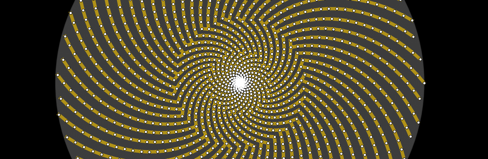

exploring the architecture of all that is
-----------------------------------------

.. image:: ./root3-harmonics-banner.png
   :align: center

**GEOMETOR** is an open-source initiative for exploring geometry, nature, and logic through symbolic modeling. We develop tools to create, visualize, and analyze geometric constructions, with a focus on discovering fundamental patterns and advancing machine reasoning.

Contents:

- `GEOMETOR Explorer`_
- `Core Libraries`_
- `Research and Exploration`_
- `Contribute`_

GEOMETOR Explorer
-----------------

.. image:: ./geom-banner.png
   :align: center

The `explorer`_ is a web-based application for creating and interacting with geometric constructions. It serves as the primary interface to the GEOMETOR ecosystem, allowing users to visually build models and engage with the underlying symbolic algebra powered by Sympy.

Core Libraries
--------------

The explorer is supported by a set of powerful libraries:

- model_: Provides the foundational classes for defining geometric elements (points, lines, circles) and their relationships.
- divine_: Analyzes models to uncover significant geometric properties, with a special focus on the golden ratio.

Research and Exploration
------------------------

We apply our modeling tools to a range of fascinating research areas:

Abstraction and Reasoning
~~~~~~~~~~~~~~~~~~~~~~~~~

.. image:: ./arc-banner.png
   :align: center

A major focus is exploring how machines can perform logical deduction, similar to solving a geometric proof. This has led to the development of **SEER**, an AI framework that uses a multi-agent system to solve abstract reasoning challenges like those in the ARC prize.

- seer_: An AI framework for perception and discernment in reasoning challenges.
- seer_navigator_: A Textual-based tool for reviewing SEER test results.
- seer_sessions_: Session logs and outputs from SEER agent tests.
- arcprize_: General code and reference materials for the ARC prize.

Patterns in Nature
~~~~~~~~~~~~~~~~~~

- phyllotaxis_: Investigates the geometric patterns of plants, particularly those related to the golden ratio.

Classical Geometry
~~~~~~~~~~~~~~~~~~

- elements_: A project to extract and codify the knowledge from Euclid's Elements.

Contribute
----------
We welcome contributions from anyone interested in geometry, mathematics, nature, or programming. Feel free to contribute to our repositories, raise issues, or propose enhancements.

Check out general info on **GEOMETOR**:

- geometor.com_

**GEOMETOR** is an organization led by `phi ARCHITECT`_

.. _`phi ARCHITECT`: https://github.com/phiarchitect
.. _explorer: https://github.com/geometor/explorer
.. _model: https://github.com/geometor/model
.. _divine: https://github.com/geometor/divine
.. _seer: https://github.com/geometor/seer
.. _seer_navigator: https://github.com/geometor/seer_navigator
.. _seer_sessions: https://github.com/geometor/seer_sessions
.. _arcprize: https://github.com/geometor/arcprize
.. _phyllotaxis: https://github.com/geometor/phyllotaxis
.. _elements: https://github.com/geometor/elements
.. _geometor.com: https://geometor.com

