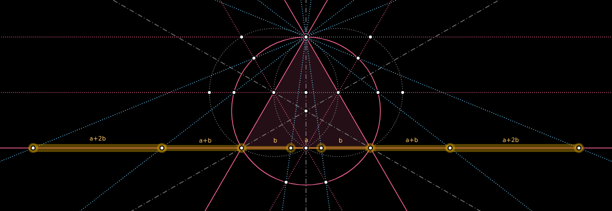
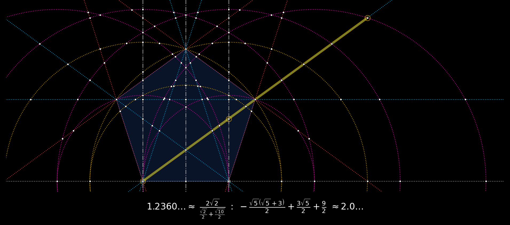

exploring the architecture of all that is
=========================================

**GEOMETOR** is an open-source initiative exploring geometry, nature, and logic through symbolic modeling, visual analysis, and machine reasoning.

The Quest for Absolute Accuracy
-------------------------------

Geometry is the fundamental blueprint of form, proportion, and reasoning in nature. Yet, traditional interactive geometry software—like GeoGebra—relies on floating-point approximations. In numerical environments, intersections and geometric relationships are computed as approximate decimal values.

At **GEOMETOR**, we believe that to truly investigate the architecture of geometry, analysis must be grounded in **exact symbolic algebra**. We are not looking for relationships that are merely *close to* the divine proportion—we are looking for **exact** mathematical truths:

.. math::

   \phi = \frac{1 + \sqrt{5}}{2}

By modeling geometry symbolically, every point, line, circle, and intersection retains its exact algebraic identity ($\sqrt{2}$, $\sqrt{3}$, $\phi$, exact polynomial roots). This guarantees absolute precision, enabling rigorous pattern discovery, automated proof, and machine reasoning.

Core Ecosystem
--------------

The GEOMETOR platform is built as a suite of modular Python libraries and interactive applications:

Symbolic Engine & Exploration
~~~~~~~~~~~~~~~~~~~~~~~~~~~~~

- `model <https://github.com/geometor/model>`_: **The Symbolic Engine**. Defines geometric elements using exact algebraic expressions, built on a modular mixin architecture.
- `explorer <https://github.com/geometor/explorer>`_: **Interactive Interface**. Web-based SVG canvas and CLI environment for building, animating, and visualizing models.
- `divine <https://github.com/geometor/divine>`_: **Harmonic & Golden Section Analysis**. Observes constructions to automatically discover golden sections, harmonic ranges, and geometric growth patterns.

Machine Intelligence & Reasoning
~~~~~~~~~~~~~~~~~~~~~~~~~~~~~~~~

- `seer <https://github.com/geometor/seer>`_: **Abstract Reasoning Engine**. Bridges symbolic geometry and AI to solve spatial logic puzzles like the ARC Challenge.
- `seer_navigator <https://github.com/geometor/seer_navigator>`_: Datatable and graphical browser for inspecting reasoning trajectories and session steps.

Classical Canon & Historical Reconstructions
~~~~~~~~~~~~~~~~~~~~~~~~~~~~~~~~~~~~~~~~~~~~

- `elements <https://github.com/geometor/elements>`_: **Euclid's Elements**. Computational reconstruction mapping the logical dependencies of classical propositions.
- `euclid <https://github.com/geometor/euclid>`_: Text extraction, semantic tagging, and color geometry integration (Oliver Byrne).
- `pacioli <https://github.com/geometor/pacioli>`_: **Luca Pacioli**. Synthesis and translation of *De Divina Proportione* (1509).
- `pappus <https://github.com/geometor/pappus>`_: **Pappus of Alexandria**. Explorations into projective theorems and harmonic cross-ratios.
- `hoenen <https://github.com/geometor/hoenen>`_: **P. H. J. Hoenen S.J.** Digitization and Latin-to-English translation of *De Noetica Geometriae Origine Theoriae Cognitionis*, exploring the epistemological foundations of geometric cognition.

Natural Patterns
~~~~~~~~~~~~~~~~

- `phyllotaxis <https://github.com/geometor/phyllotaxis>`_: **Patterns in Nature**. Investigating plant growth, Fibonacci spirals, and cellular packing principles.

Connect & Contribute
--------------------

- **Website**: `geometor.com <https://geometor.com>`_
- **Discussions**: Join the community on `GitHub Discussions <https://github.com/orgs/geometor/discussions>`_.

---

**GEOMETOR** is led by `phi ARCHITECT <https://github.com/phiarchitect>`_.
